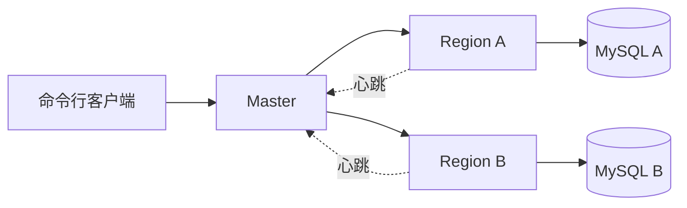

# 分布式一致性与可用性演示

客户端通过单个 Python Master 读写固定的 `students` 表。Master 通过 HTTP 心跳维护两个 Region 的可用状态，每个 Region 用本地 InnoDB 事务读写各自的 MySQL。Master 持久化操作版本和待同步状态，并在降级后由操作者指定源副本进行整表同步。



| 写入策略 | 返回成功的条件 | 一个副本不可用时 |
| --- | --- | --- |
| `all`（默认） | 两个 MySQL 均确认本地事务提交 | 已知不可用时提前拒绝 |
| `available` | 至少一个正常副本确认本地事务提交 | 继续写入正常副本，落后副本等待补同步 |

两个 MySQL 独立提交。请求过程中发生故障时，`all` 可能已在一侧提交。响应会显示确认、失败和未确认的节点，Master 暂停普通读写，等待人工核对。Master 本身为单实例，Master 故障会中断服务。跨机器演示请使用组内可信局域网，HTTP 接口未配置认证和 TLS。

## 组内交接

开发初测使用本机两个独立的 MySQL 8.0.39 实例，验证了双写入库、单 Region 下线、单 MySQL 停机、降级删除、Master 重启后保留待同步状态，以及恢复后两库对齐。

接手验收的同学可先按下面的「三台机器部署」启动，再顺序执行「演示步骤」。记录故障前后的 `status`、写入确认结果和同步前后的 `compare` 输出。实际三机联调和 Compose 启动仍待组内验收。

## Compose 联调

在本目录执行。将 `.env.example` 复制为 `.env`，替换其中的两个占位密码。

```bash
cp .env.example .env        # PowerShell 用 Copy-Item .env.example .env
docker compose up -d --build
docker compose ps
docker compose exec master python client.py status
```

首次演示前，用 `status` 确认两个 Region 均为 `online=true`、`db_ready=true`、`needs_sync=false`，且 Master 为 `blocked=false`。Compose 启动一个 Master、两个 Region 和两个 MySQL 8.4 实例，两个 MySQL 首次启动会执行 `sql/init.sql`。宿主机可通过 `http://127.0.0.1:5000` 访问 Master。容器中的 Region 使用服务名访问 Master 和 MySQL。 [Compose 启动顺序](https://docs.docker.com/compose/how-tos/startup-order/) · [MySQL 官方镜像](https://hub.docker.com/_/mysql)

使用 `docker compose down` 停止服务，数据库和 Master 状态会保存在三个独立的命名卷中。首次初始化使用的密码保存在 MySQL 的数据卷中，修改 `.env` 不会修改已有数据库账户的密码。需要清空整套课堂数据时，确认三个卷里的数据都可以丢弃，再运行 `docker compose down --volumes` 并重新启动。

## 三台机器部署

每台机器进入本目录，安装 Python 3.10 或更高版本和项目依赖。

```bash
python -m pip install -r requirements.txt
```

示例局域网地址为 `192.168.1.10`（Master）、`192.168.1.11`（A）、`192.168.1.12`（B）。实际部署时替换这三个地址。在 A、B 各运行一个 MySQL 实例，服务仅需接受本机连接。每台 Region 机器用 MySQL 管理账号在本目录启动 `mysql -u root -p`，执行以下 SQL 初始化本地实例。两个节点的密码可分别设置。

```sql
CREATE DATABASE IF NOT EXISTS routing_demo CHARACTER SET utf8mb4;
CREATE USER IF NOT EXISTS 'routing_demo'@'127.0.0.1' IDENTIFIED BY 'your-app-password';
GRANT SELECT, INSERT, UPDATE, DELETE ON routing_demo.* TO 'routing_demo'@'127.0.0.1';
USE routing_demo;
SOURCE sql/init.sql
```

Master 机器运行以下命令。

```bash
python master.py --host 0.0.0.0 --port 5000
```

在两台 Region 机器分别设置本机 MySQL 连接环境变量。把密码占位值替换为设置账户时使用的密码。

```powershell
$env:MYSQL_HOST = '127.0.0.1'
$env:MYSQL_PORT = '3306'
$env:MYSQL_DATABASE = 'routing_demo'
$env:MYSQL_USER = 'routing_demo'
$env:MYSQL_PASSWORD = 'your-app-password'
```

```bash
export MYSQL_HOST=127.0.0.1 MYSQL_PORT=3306 MYSQL_DATABASE=routing_demo
export MYSQL_USER=routing_demo MYSQL_PASSWORD='your-app-password'
```

分别在 A 和 B 启动 Region，各运行对应的一行命令。

```bash
python region_server.py --name region-a --host 0.0.0.0 --port 5001 --advertise http://192.168.1.11:5001 --master http://192.168.1.10:5000
python region_server.py --name region-b --host 0.0.0.0 --port 5001 --advertise http://192.168.1.12:5001 --master http://192.168.1.10:5000
```

防火墙需允许客户端及 Region 访问 Master 的 TCP 5000，允许 Master 访问两台 Region 的 TCP 5001。Region 的 `--advertise` 是 Master 用于回连的 HTTP 地址。检查 Master 收到的节点状态，在 Region 本机访问 `http://127.0.0.1:5001/health` 可以区分 MySQL 可用和数据库连接或初始化失败。

```bash
python client.py --master http://192.168.1.10:5000 status
```

默认每秒上报一次心跳，超过 5 秒未收到心跳的 Region 会被判定不可用。`--heartbeat-interval` 和 Master 的 `--heartbeat-timeout` 可改这两个时间。正常停止时按 Ctrl+C，保留两个 MySQL 的数据及 Master 的 `master_state.json`。

## 使用本机已有的 MySQL

此方式用同一个 MySQL 进程下的两个 schema 做开发联调。使用管理账号建库、授权，并分别选择两个库运行相同的初始化脚本。

```sql
CREATE DATABASE IF NOT EXISTS region_a CHARACTER SET utf8mb4;
CREATE DATABASE IF NOT EXISTS region_b CHARACTER SET utf8mb4;
CREATE USER IF NOT EXISTS 'routing_demo'@'127.0.0.1' IDENTIFIED BY 'your-app-password';
GRANT SELECT, INSERT, UPDATE, DELETE ON region_a.* TO 'routing_demo'@'127.0.0.1';
GRANT SELECT, INSERT, UPDATE, DELETE ON region_b.* TO 'routing_demo'@'127.0.0.1';
USE region_a;
SOURCE sql/init.sql
USE region_b;
SOURCE sql/init.sql
```

按三机步骤安装依赖并设置 `MYSQL_PASSWORD`，随后运行 `python run.py`。启动器默认连接 `127.0.0.1:3306`，可通过 `python run.py --help` 查看数据库配置项。保持该进程运行，另开终端执行 `python client.py status`。两个 schema 共享故障域，独立数据库实例故障请用 Compose 或三机部署验证。

## 演示步骤

以下命令使用 Compose。从其他机器操作时，将 `docker compose exec master python client.py` 替换为 `python client.py --master http://192.168.1.10:5000`，并在相应机器停启 Region 或 MySQL。

1. 正常写入两条记录，再查询并比较两库。

   ```bash
   docker compose exec master python client.py upsert 1001 Alice 90
   docker compose exec master python client.py upsert 1002 Bob 84
   docker compose exec master python client.py read 1001
   docker compose exec master python client.py compare
   ```

   两次写入均应确认两个副本。读取显示来源节点和记录版本，比较结果的 `equal` 应为 `true`。

2. 停止 B 的 Region，重复执行 `status` 直到 B 的 `online=false`，再分别发出 `all` 与 `available` 写入。第一条写入命令预期以非零状态退出。

   ```bash
   docker compose stop region-b
   docker compose exec master python client.py status
   docker compose exec master python client.py upsert 1001 Alice 95 --policy all
   docker compose exec master python client.py read 1001
   docker compose exec master python client.py upsert 1001 Alice 96 --policy available
   docker compose exec master python client.py delete 1002 --policy available
   ```

   `all` 拒绝后仍能读到 90 分。两条 `available` 操作均应由 A 确认，B 被标记待同步。

3. 恢复 B 的 Region，重复执行 `status` 直到 B 的 `online=true` 且 `db_ready=true`。核对 A 的 1001 已改为 96 分、A 已删除 1002 而 B 仍保留该记录，再以 A 为源同步。

   ```bash
   docker compose start region-b
   docker compose exec master python client.py status
   docker compose exec master python client.py compare
   docker compose exec master python client.py sync --source region-a
   docker compose exec master python client.py compare
   docker compose exec master python client.py status
   ```

   完成后两侧均应有 96 分的 1001 记录，1002 均应已删除，待同步标记应清空。

4. 保持 B 的 Region 运行，单独停止 MySQL B。重复执行 `status` 直到 B 的 `online=true` 且 `db_ready=false`，再执行两次更新。第一条写入命令预期以非零状态退出。

   ```bash
   docker compose stop mysql-b
   docker compose exec master python client.py status
   docker compose exec master python client.py upsert 1001 Alice 97 --policy all
   docker compose exec master python client.py upsert 1001 Alice 98 --policy available
   docker compose start mysql-b
   ```

   等待 B 的数据库恢复可用，按上一步核对和同步。同步后两端的 1001 都应为 98 分。

`confirmed` 是已确认提交的节点，`failed` 是明确失败的节点，`unknown` 是提交结果未确认的节点，`skipped` 是未分派的节点。`all` 只确认一个副本，或任一策略未获得提交确认且存在未确认结果时，Master 会暂停普通读写。`available` 获得一个副本的提交确认后，可继续在已确认的副本读写。

恢复前先用 `status` 和 `compare` 核对记录及操作结果，再用 `sync --source` 指定源副本。补同步会覆盖另一副本的整张表，也会删除目标端多出的记录。选中落后的源副本会覆盖另一端的新数据，选择时需核对预期的增删改，不能单凭版本号决定。

演示期间的业务操作统一通过 Master。若 Master 在写入或同步过程中退出，持久化的未完成操作会阻止普通读写，直至完成核对与同步。若更换数据库、还原备份或丢失 Master 状态文件，先比较两个副本的数据和已应用版本，再选择权威源进行同步。

## 来源

本项目保留原项目作者及共同贡献者的贡献归属。 [Ctrl1CandV/distributed-database](https://github.com/Ctrl1CandV/distributed-database) · [来源说明](SOURCE.md)
