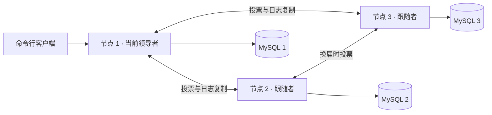

# 系统设计与算法

每个节点运行同一个 HTTP 服务和 Raft 状态机，持有自己的 MySQL 数据库。逻辑上的领导者会变化，客户端可以向任意节点查询状态，随后向领导者发送增删和强一致读。各节点复制同一张学生表，可用节点数达到多数时，集群可在重新选主后恢复读写。

之前的项目由固定 Master 逐个请求副本并等待双写，副本产生分歧后需要人工选源覆盖。新版由每个节点持久化同一份有序操作日志，通过多数派交集和日志新旧规则保留已经提交的历史。选择 Raft 可以用同一套协议串起选主、变更顺序和恢复，不需要在这三个流程之间另外协调主节点或覆盖整张表。

## 可展示的算法

| 机制 | 代码中的行为 | 演示证据 |
| --- | --- | --- |
| 预投票 | 进入换届前先问其他节点是否可能支持，预投票本身不推进任期、不改持久化投票。收到近期领导者心跳的节点可拒绝 | 隔离一个跟随者后观察任期，再对比 `raft.pre_vote=false` |
| 随机超时与选举 | 跟随者超时后发起竞选。按最后日志的任期和下标比较新旧，每个任期最多投给一名候选者 | 停掉领导者，观察另一节点的角色和任期变化 |
| 日志复制与多数派提交 | 领导者按跟随者进度并发发送有序日志。日志落盘获得多数确认后，领导者可提交本任期对应项及其前缀 | 写入响应中的 `index`、`term`，各节点的 `match_index`、`commit_index` |
| 前缀检查与冲突回退 | 比较上一条日志的下标和任期。发现冲突后从跟随者返回的下标继续尝试。仅替换冲突的未提交后缀 | 旧领导者隔离期间的未确认写入在恢复后被覆盖 |
| 读屏障与副本本地读 | 强一致读先提交一条当前任期的空操作，再从本机已应用的状态读取。本地读直接返回当前节点已应用的数据 | 失去多数时强一致读无法完成，健康节点仍可执行本地读 |

预投票是 Raft 选举的扩展。复制与提交规则可对照 [Raft 原论文](https://raft.github.io/raft.pdf) 第 5 节，强一致读的约束可对照第 8 节。本实现把读请求作为空操作写入日志，增加复制和落盘开销，便于在演示中观察读的多数派确认过程。

## 一次写入何时可见

1. 领导者为增删命令分配日志下标。姓名、分数和更新时间随该命令复制，各副本应用同一份内容。
2. 跟随者通过上一条日志的下标和任期检查前缀，写入自己的 MySQL 后回复。
3. 领导者确认至少 `floor(N/2)+1` 个节点复制了该项。在本任期的项满足这个条件时，领导者推进提交位置。
4. 单节点把新提交位置之前的命令依次应用。学生表更新和提交位置推进处于同一个 InnoDB 事务，写入响应在领导者完成本地事务后返回。
5. 跟随者从后续的 AppendEntries 得知提交位置，逐步追上。读取的 `index` 是这个节点已应用的位置，记录的 `version` 是最后一次修改该记录的日志下标。

MySQL 中 `raft_identity` 绑定节点身份、集群和成员指纹，`raft_hard_state` 保存任期、投票和提交下标，`raft_log` 保存命令，`students` 是已应用的学生记录。MySQL 故障时节点暂停投票、复制确认和读取。运行中的节点在数据库重新可用后重载持久状态，以跟随者身份加入。

## 容错范围

| 启动节点数 | 多数派要求 | 可容忍同时失去的节点数 |
| --- | --- | --- |
| 1 | 1 | 0 |
| 2 | 2 | 0 |
| 3 | 2 | 1 |
| 5 | 3 | 2 |

可用性的前提是多数节点能够互相通信，而且各自的 MySQL 可用。同一节点进程能启动却连不上 MySQL 时，该节点不算可用。网络分区中，少数派可能暂时仍显示旧领导者。领导者角色来自节点本地认知，能否成功提交由多数派决定。调用侧超时也可能发生在命令提交之后，须查询后判断结果。

这给出两种可以对照的 CAP 取舍。写入和强一致读在失去多数派时拒绝确认，保住已提交的数据顺序。本地读只依赖当前节点的 MySQL，因此隔离时仍可读取，但结果可能滞后。演示时应分别记录两种读的返回值、版本和是否成功。

节点数可在首次部署时按需配置。本原型使用固定成员、有完整日志的恢复方式，适用于节点进程或数据库暂时失联且原持久数据仍在的场景。持续运行时日志会增长，成员变更、日志压缩和灾后备份恢复留作扩展。启动时应给每个节点分配独立数据库，不要在线替换为历史备份或空库。
